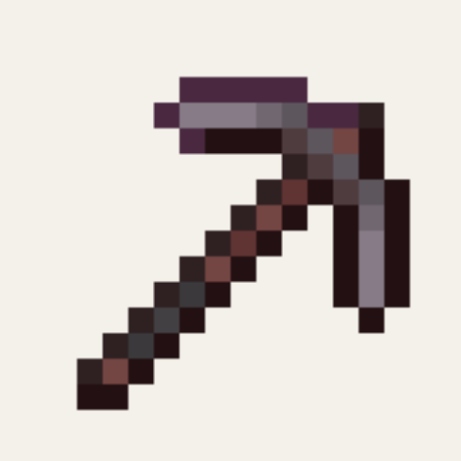

<p align="center"></p>

<h1 align="center">⛏️ Fast Miner</h1>

<p align="center"><b>Break multiple blocks faster, faster, faster!</b></p>

<p align="center">
  
  
  
  
  
  <a href="https://github.com/tariksharabaty/o-lib"></a>
  <a href="https://modrinth.com/organization/oidioomstudio"></a>
  <a href="https://oidioom.com"></a>
</p>

<p align="center"><a href="#-english">🇬🇧 English</a> · <a href="#-türkçe">🇹🇷 Türkçe</a></p>

---

## 🇬🇧 English

> [!IMPORTANT]
> Requires **[O Lib](https://github.com/tariksharabaty/o-lib)** and **Fabric API**.

**Fast Miner** is a modern, responsive, and performance-optimized vein-mining mod built for Minecraft 26.3. Inspired by legendary tools like FTB Ultimine, Fast Miner lets you harvest whole ore veins or carve precise geometric tunnels with a single keypress.

---

## ✨ Key Features

- 🎮 **Activated On-Demand:** Hold your Fast Miner hotkey (Default: `` ` `` / Grave) to instantly mine connected blocks.
- 📐 **Multiple Excavation Shapes:**
  - **Shapeless / Vein:** Mined ore clusters and natural veins effortlessly.
  - **Small Tunnel (1x2):** Perfect for standard cave exploration.
  - **Large Tunnel (3x3):** Clear out massive mine shafts in seconds.
  - **Mining Tunnel (3x3 with ceiling preservation):** Safely carve hallways.
  - **Escape Tunnel:** Upward diagonal staircase digging.
  - **Diagonal Tunnel:** Downward stairs carving.
- 🔄 **Cycle Shapes In-Game:** Use the cycle shape keybinds (Default: `Arrow Up` / `Arrow Down`) to change shapes on the fly.
- 🧰 **Right-Click Utility Actions:** Strip logs, flatten grass with shovels, or till entire fields with hoes in one stroke!
- 🛡️ **Tool Breakage Protection:** Automatically stops before your precious enchanted pickaxe breaks.
- 🍖 **Hunger & Exhaustion Balance:** Balances large block breaking by consuming hunger, configurable to your liking.
- 🎒 **Magnetized Drops:** Directly sends mined resources to your inventory using `OInventoryHelper`.

---

## ⚙️ In-Game Configuration

Access settings via **ModMenu** or the **O Lib** hotkey:
- `maxBlocks`: Maximum blocks mined per operation (Default: 64).
- `exhaustionPerBlock`: Hunger cost per block broken.
- `preventToolBreak`: Avoid shattering tools with 1 durability remaining.
- `teleportDrops`: Directly deposit mined drops into player inventory.

---

## 📥 Installation

1. Install **Minecraft 26.3** with **Fabric Loader**.
2. Install **Fabric API**.
3. Install **O Lib** (required core library).
4. Drop `fast-miner-1.1.2-mc26.3.jar` into your `mods` folder.

---

## ⬇️ Download

- **Modrinth:** [Oidioom Studio](https://modrinth.com/organization/oidioomstudio)
- **GitHub Releases:** [`fast-miner-1.1.2-mc26.3.jar`](../../releases/latest)

## 🔨 Building from source

Requires **JDK 25**.

```bash
# 1) O Lib is a dependency — publish it to your local Maven first
git clone https://github.com/tariksharabaty/o-lib.git
(cd o-lib && ./gradlew publishToMavenLocal)

# 2) build this mod
./gradlew build
# output: build/libs/fast-miner-1.1.2-mc26.3.jar
```

## 📄 License

[MIT](LICENSE) © 2026 Oidioom / Tarek Sharabaty

---

## 🇹🇷 Türkçe

**Zahmetsiz damar kazma ve geometrik tünel açma; güç kaynağı O Lib.**

> [!IMPORTANT]
> **[O Lib](https://github.com/tariksharabaty/o-lib)** ve **Fabric API** gerektirir.

### ✨ Özellikler

- Kısayol tuşunu basılı tutarak bağlı blokları tek seferde kazma
- Birden çok kazı şekli: damar, 1x2, 3x3, kaçış ve çapraz tünel
- Oyun içinde şekiller arasında geçiş
- Sağ tıkla toplu kütük soyma, yol açma ve toprak sürme
- Alet kırılma koruması, açlık dengesi, düşenleri envantere çekme

### 📥 Kurulum

1. **Minecraft 26.3** için **Fabric Loader** kurun.
2. **Fabric API** ve **O Lib** modlarını `mods` klasörüne ekleyin.
3. `fast-miner-1.1.2-mc26.3.jar` dosyasını `mods` klasörüne atın ve oyunu başlatın.

### ⬇️ İndir

- **Modrinth:** [Oidioom Studio](https://modrinth.com/organization/oidioomstudio)
- **GitHub Releases:** [`fast-miner-1.1.2-mc26.3.jar`](../../releases/latest)

### 📄 Lisans

[MIT](LICENSE) © 2026 Oidioom / Tarek Sharabaty

---

<p align="center"><a href="https://oidioom.com"></a></p>
<p align="center"><b>by Oidioom — Tarek Sharabaty</b><br>
<a href="https://oidioom.com">oidioom.com</a> · <a href="https://github.com/tariksharabaty">GitHub</a> · <a href="https://modrinth.com/organization/oidioomstudio">Modrinth</a> · <a href="https://gear.oidioom.com">Gear</a> · <a href="https://www.instagram.com/oidioom">Instagram</a></p>
